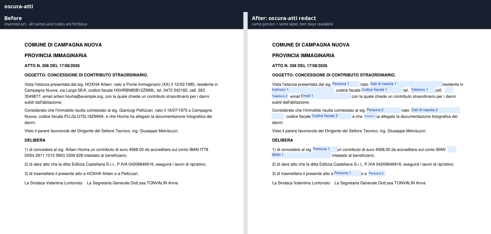
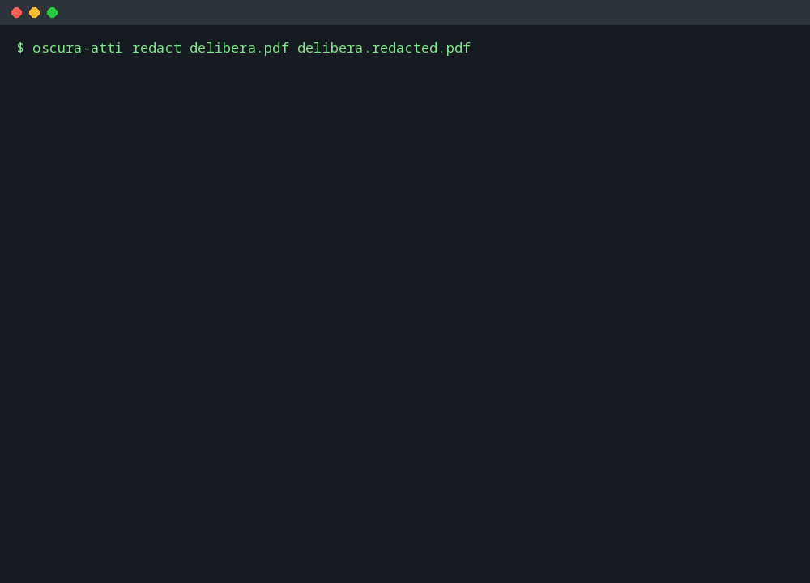
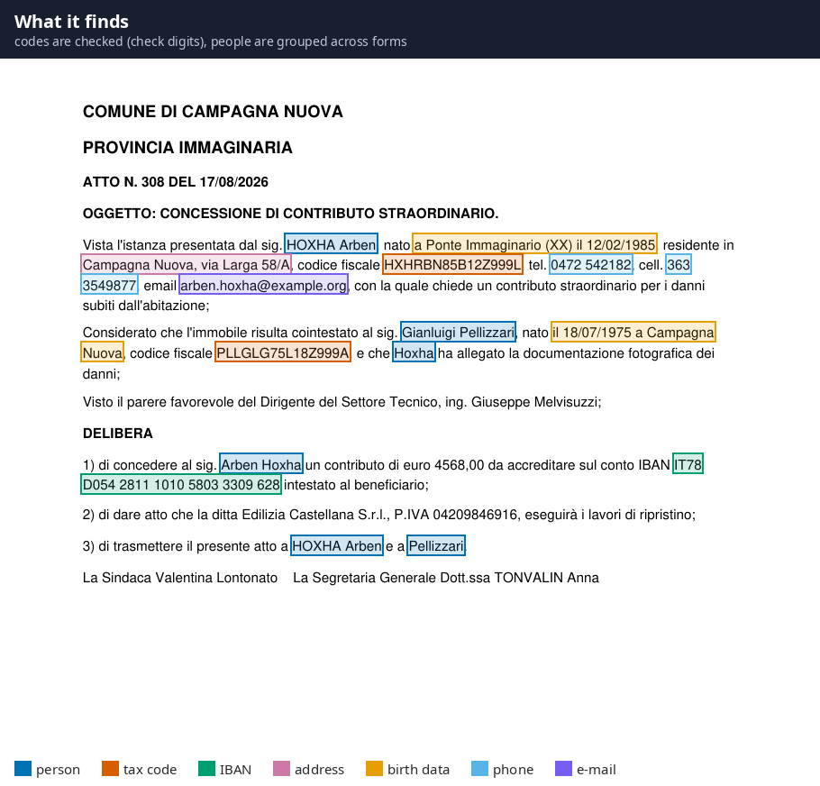
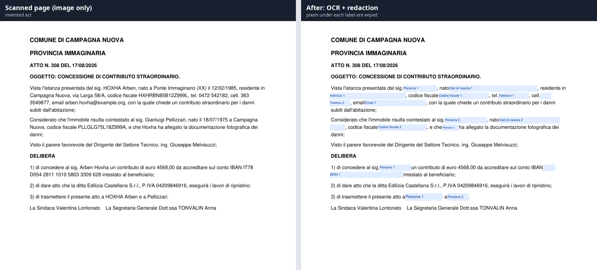

# oscura-atti

[English](README.md) · **Italiano**

[](https://github.com/francescor/oscura-atti/actions/workflows/tests.yml)
[](https://pypi.org/project/oscura-atti/)
[](https://registry.modelcontextprotocol.io/v0.1/servers?search=io.github.francescor/oscura-atti)
[](https://scorecard.dev/viewer/?uri=github.com/francescor/oscura-atti)
[](LICENSE)

<!-- mcp-name: io.github.francescor/oscura-atti -->

**Oscuramento dei dati personali (PII, *personally identifiable information*) in locale, a regole: niente cloud, niente apprendimento automatico
obbligatorio. Si usa come server MCP per Claude e gli altri agenti di IA, da riga di comando, come
libreria Python o come immagine Docker.**

Oscura i dati personali negli atti della pubblica amministrazione (PDF, PDF firmati `.p7m`,
Word/Excel/OpenDocument, immagini, testo) per poterli ripubblicare, sostituendo ogni dato con
un'**etichetta coerente** invece che con un riquadro nero:

> Vista l'istanza del sig. **Persona 1**, nato **Dati di nascita 1**, residente in **Indirizzo 1**,
> codice fiscale **Codice fiscale 1** … di concedere al sig. **Persona 1** un contributo da accreditare
> sull'IBAN **IBAN 1** … di trasmettere copia a **Persona 1** e alla sig.ra **Persona 2**.



<p align="center"></p>
<p align="center"><em>Dimostrazione su un atto inventato (<a href="docs/media/demo.mp4">video MP4</a>). Tutti i nomi, i codici e gli indirizzi di queste immagini sono di fantasia.</em></p>

La stessa persona è sempre `Persona 1` in tutto il documento, un'altra persona è `Persona 2`, e così
via per codici fiscali, IBAN, indirizzi, dati di nascita, telefoni, email, targhe e documenti
d'identità. Il testo resta leggibile e la vicenda dell'atto resta comprensibile; le persone no.

In breve:

- **Gira sul tuo computer.** I documenti non vengono inviati da nessuna parte e non si conserva nulla,
  nemmeno la corrispondenza tra valori ed etichette.
- **Server MCP** con due strumenti, `analyse_pdf` e `redact_pdf`: un agente di IA può produrre la copia
  oscurata partendo dal percorso del file e riceve un rapporto senza i dati personali
  ([configurazione](#server-mcp)).
- **Controlla il proprio risultato.** La copia oscurata viene riletta (anche con l'OCR) e ogni dato
  ancora estraibile viene segnalato; i documenti dubbi finiscono con esito `review`, perché decida una persona.
- **Pensato e provato sugli atti della PA italiana.** Ci sono anche i pacchetti per codici e titoli
  di cortesia di Regno Unito, Spagna, Francia e Germania, ma il benchmark e la prova reale qui sotto
  sono su atti italiani.

È nato come risposta a una domanda sul forum di Developers Italia: [*API/MCP per oscurare i dati
personali nelle delibere a fine pubblicazione in albo?*](https://forum.italia.it/t/api-mcp-per-oscurare-i-dati-personali-nelle-delibere-a-fine-pubblicazione-in-albo/49338)

## Perché

Molti enti pubblici europei devono pubblicare i propri atti per un tempo limitato. In Italia
delibere, ordinanze e determine restano all'*Albo pretorio online* per 15 giorni; dopo, secondo il
Garante per la protezione dei dati personali (linee guida 243/2014), i dati personali che contengono
non possono più essere diffusi: chi li tiene online — l'ente stesso o un archivio civico che li ha
conservati — deve prima toglierli. Farlo a mano, atto per atto, non è sostenibile. `oscura-atti` fa
la parte meccanica e segnala all'operatore ciò che richiede una decisione.

## Come funziona

1. **Modello del testo.** Il PDF viene letto carattere per carattere, conservando la posizione di
   ogni lettera. Le pagine scansionate (o fatte quasi solo di un'immagine, come una scansione con
   sopra il timbro di protocollo) passano dall'OCR di Tesseract.
2. **Riconoscitori** (regole: niente cloud, nessun modello di intelligenza artificiale obbligatorio):
   - codici **con cifra di controllo**: codice fiscale (anche omocodico e rovinato dall'OCR),
     partita IVA, IBAN (tutti i paesi SEPA), carte di pagamento (Luhn), National Insurance e NHS
     britannici, DNI/NIE spagnoli, NIR francese, Steuer-ID tedesca;
   - numeri di telefono, email, targhe e documenti d'identità (con il contesto);
   - **dati di nascita** («nato a Treviso il 03/04/1971») e **indirizzi di residenza** («residente in via …»);
   - **persone**: titoli (sig., dott.ssa, Mr, Mme, Frau, Doña…), «il sottoscritto», «nato a», parole
     di relazione («a favore di», «coniuge», «defunto», «cittadino»…) e le forme `COGNOME Nome` e
     `Cognome Nome` tipiche di elenchi e verbali, validate con un elenco di nomi di battesimo.
3. **Entità.** Le menzioni della stessa persona vengono unite («Mario Rossi», «ROSSI Mario», «Rossi»,
   varianti dell'OCR), poi si cercano tutte le altre occorrenze di quel cognome nel documento.
4. **Decisioni.** Le figure pubbliche restano leggibili: i nomi della configurazione (sindaco,
   consiglieri, funzionari) e i nomi vicini a un ruolo pubblico («il Dirigente», «Sindaca», un
   elenco sotto «Consiglieri:»). Le imprese (`S.r.l.`, `ditta`…) non sono persone.
5. **Riscrittura.** Il testo sotto ogni riquadro viene tolto dal PDF (non solo coperto), i pixel
   delle immagini vengono cancellati, l'etichetta viene scritta al suo posto; si tolgono metadati,
   allegati, annotazioni e campi dei moduli; una riga a piè di pagina lo spiega: *«Documento generato
   dall'originale oscurando i dati personali; restano visibili i nomi di amministratori e funzionari
   nel loro ruolo pubblico»*. **Se non c'è nulla da oscurare, si ottiene il file originale identico,
   byte per byte**: stesso SHA-256, firma digitale conservata, nessun timbro. Se i dati personali
   stanno solo nelle proprietà del file (autore, titolo…), si tolgono solo quelli e il timbro dice
   che il testo è invariato.
6. **Verifica.** Il risultato viene riletto (e ripassato all'OCR per le pagine scansionate): ogni
   dato oscurato ancora estraibile viene segnalato come perdita.

Non si conserva nulla: la corrispondenza tra dati ed etichette esiste solo durante l'elaborazione.

| Cosa trova | Anche nelle scansioni |
|---|---|
|  |  |

## Installazione

```bash
pip install oscura-atti          # oppure senza installarlo: uvx oscura-atti --help
# OCR per le pagine scansionate:
sudo apt install tesseract-ocr tesseract-ocr-ita   # oppure -eng, -spa, -fra, -deu
```

Python ≥ 3.11. Per i PDF si usa [PyMuPDF](https://pymupdf.readthedocs.io/) (AGPL), per questo anche
il progetto è AGPL-3.0. Facoltativi: LibreOffice (`soffice`) per convertire i documenti d'ufficio;
l'extra `ner` (`pip install "oscura-atti[ner]"`, ~2 GB con PyTorch) per un modello neurale che
trova anche i nomi senza alcun indizio nel contesto.

I client MCP che leggono il [registro ufficiale MCP](https://registry.modelcontextprotocol.io/v0.1/servers?search=io.github.francescor/oscura-atti) possono installarlo da lì: la voce
`io.github.francescor/oscura-atti` lo avvia con `uvx oscura-atti mcp` o con l'immagine Docker.

## Docker

Un'immagine pronta con OCR (Tesseract: italiano, inglese, spagnolo, francese, tedesco) e LibreOffice
viene pubblicata in `ghcr.io/francescor/oscura-atti` (linux/amd64 e linux/arm64) dal workflow GitHub
`publish`. Il container gira con un utente senza privilegi; `/data` è l'unica cartella che gli
strumenti possono leggere e scrivere tramite percorso.

Le immagini delle release sono firmate con [cosign](https://docs.sigstore.dev/) (senza chiavi, dal
workflow GitHub) e hanno SBOM e attestazione di provenienza. Per controllare che un'immagine sia stata
costruita da questo repository:

```bash
cosign verify ghcr.io/francescor/oscura-atti:0.1.1 \
  --certificate-identity-regexp '^https://github.com/francescor/oscura-atti/\.github/workflows/publish\.yml@refs/tags/v' \
  --certificate-oidc-issuer https://token.actions.githubusercontent.com
```

**Uso singolo (riga di comando):**

```bash
docker run --rm -v "$PWD:/data" ghcr.io/francescor/oscura-atti redact /data/atto.pdf /data/atto.oscurato.pdf
docker run --rm -v "$PWD:/data" ghcr.io/francescor/oscura-atti batch /data/in /data/out --jobs 4 --learn-public
```

**Server MCP con Docker Compose** ([`docker-compose.yml`](docker-compose.yml)): risponde su
`http://127.0.0.1:8000/mcp`, documenti in `./data`.

```bash
docker compose up -d
claude mcp add --transport http oscura-atti http://127.0.0.1:8000/mcp     # Claude Code
docker compose run --rm oscura-atti redact /data/atto.pdf /data/atto.oscurato.pdf
```

**Stack Docker Swarm dietro Traefik** ([`deploy/swarm-stack.yml`](deploy/swarm-stack.yml)): due
repliche, aggiornamenti progressivi, limiti di memoria, TLS e accesso tramite forward auth di
authentik oppure basic auth di Traefik (il server non ha un'autenticazione propria: non esporlo mai
senza).

```bash
docker stack deploy --with-registry-auth --prune -c deploy/swarm-stack.yml oscura-atti
```

Per costruirla da sé: `docker build -t oscura-atti .` (con `--build-arg WITH_OFFICE=false` per
un'immagine più leggera senza LibreOffice, `--build-arg OCR_LANGS="ita eng"` per scegliere le lingue
dell'OCR).

## Riga di comando

```bash
oscura-atti sample esempio.pdf                    # un atto INVENTATO su cui provare
oscura-atti analyse esempio.pdf                   # cosa verrebbe oscurato, con i valori (per l'operatore)
oscura-atti redact esempio.pdf esempio.oscurato.pdf --report rapporto.json
oscura-atti redact atto.pdf out.pdf --keep "Mario Rossi" --add "Giulia Ghiotto"   # correzioni dell'operatore
oscura-atti batch cartella_in/ cartella_out/ --config ente.json --jobs 8
oscura-atti redact lettera.pdf out.pdf --language en --packs common,uk
oscura-atti redact modulo.docx modulo.oscurato.pdf  # documenti d'ufficio e immagini diventano PDF oscurati
```

`redact` esce con codice 2 quando l'esito è `review`: **non pubblicare quei documenti senza un
controllo umano.** Motivi di `review`: nomi ambigui, tipi da segnalare, termini di categorie
particolari (salute, minori, assistenza sociale) vicino a un privato, pagine non leggibili o perdite
trovate dalla verifica.

## Server MCP

```bash
oscura-atti mcp                      # stdio
oscura-atti mcp --http --port 8000   # Streamable HTTP su /mcp
```

Claude Code, con i percorsi di file ammessi nella cartella corrente:

```bash
claude mcp add oscura-atti -e OSCURA_ATTI_DIR="$PWD" -- uvx oscura-atti mcp
```

Poi basta chiedere, per esempio: *«Oscura atto.pdf con oscura-atti in atto.oscurato.pdf e dimmi
l'esito»*. Con `path` e `output_path` l'agente non maneggia mai il documento: `redact_pdf` restituisce
solo il rapporto, senza i valori. `analyse_pdf` invece restituisce i valori, per il controllo
dell'operatore. Strumenti:

| strumento | cosa fa |
|---|---|
| `analyse_pdf(pdf_base64 \| path, config, add, keep, filename)` | entità trovate, con l'etichetta che avranno e i valori (per l'operatore) |
| `redact_pdf(pdf_base64 \| path, output_path, config, add, keep, filename)` | PDF oscurato (Base64 o file) + rapporto senza i valori |

`filename` indica il formato dei documenti che non sono PDF (`.docx`, `.png`…). I percorsi di file
funzionano solo dentro la cartella indicata da `OSCURA_ATTI_DIR`.

## Configurazione

```json
{
  "language": "it",
  "packs": ["common", "it"],
  "public_persons": ["Lucia Esemplari", "Paolo Modellini"],
  "public_domains": ["comune.example.it"],
  "public_values": ["0499 000000"],
  "policy": {"VAT_NUMBER": "flag", "PLATE": "redact"},
  "labels": {"PERSON": "Cittadino {n}"},
  "style": "label",
  "stamp": "",
  "ocr": true,
  "ocr_language": "ita"
}
```

- `language`: lingua di etichette e timbro (`it`, `en`, `es`, `fr`, `de`).
- `packs`: `common` (email, IBAN, carte, telefoni internazionali) + `it`, `uk`, `es`, `fr`, `de`.
- `policy`: per tipo, `redact` (con eccezioni di contesto: telefoni ed email d'ufficio, partite IVA e
  IBAN di imprese ed enti), `always`, `flag` (resta leggibile, ma segnalato) o `keep`. Tipi: `PERSON`,
  `TAX_CODE`, `ID_DOCUMENT`, `HEALTH_ID`, `IBAN`, `PAYMENT_CARD`, `EMAIL`, `PHONE`, `BIRTH`,
  `ADDRESS`, `PLATE`, `VAT_NUMBER`.
- `style`: `label` (riquadro chiaro) o `black` (riquadro nero, etichetta bianca). `stamp`: `""` timbro
  predefinito, `null` nessuno, oppure un testo a scelta.
- Le chiavi che iniziano con `_` sono commenti.

## Qualità

`python -m oscura_atti.bench --n 500 [--scanned-every 1]` genera atti inventati di cui conosce la
«verità» e misura le perdite (dati privati ancora estraibili, anche una sola parola di un nome) e
l'eccesso di oscuramento (nomi pubblici persi).

Risultati attuali (v0.1.0, novembre 2026):

| insieme di prova | documenti | dati privati | sfuggiti | dati pubblici | oscurati per errore |
|---|---|---|---|---|---|
| atti inventati, nativi digitali | 600 | 4.113 | 0 | 2.403 | 0 |
| atti inventati, scansionati (OCR) | 60 | 385 | 0 | 253 | 0 |

Primo uso reale: gli atti scaduti dall'Albo pretorio di un Comune italiano (405 file: PDF, Word,
Excel, immagini, uno zip; 2.344 pagine, 86 con OCR): 100 documenti oscurati, 291 restituiti identici
(nulla da oscurare), 13 con dati personali solo nelle proprietà del file; nessun dato ancora
estraibile dopo l'oscuramento, 7 documenti da rivedere. Ogni falso positivo e falso negativo trovato
rivedendo quel giro (a mano e con un modello neurale come secondo parere) è diventato un test con
dati inventati. La suite di test (`pytest -n auto`) ha circa 140 casi. Sui documenti reali bisogna
sempre rivedere gli esiti `review`: lo strumento aiuta una decisione umana, non la sostituisce.

Cosa hanno insegnato gli atti comunali veri (ogni caso è ora un test con dati inventati): i titoli in
maiuscolo non sono persone («DISPOSIZIONI FINALI»); il nome di battesimo deve essere vero («ROSSI
Mario» sì, «DIFESA Civile» no); vie, scuole e associazioni intitolate a persone restano leggibili
(«via don E. Fantasin», «I.S.I.S. Domenico Inventati», «Ing. X» come nome di un'associazione); i
funzionari compaiono come «il documento è stato firmato da», «sostituito in caso di assenza dal
Dott.», «Responsabile del procedimento:»; telefoni ed email d'ufficio, partite IVA e IBAN di imprese
non sono dati personali; l'OCR legge lo stesso codice fiscale in modi diversi da pagina a pagina.

Limiti noti: i nomi senza indizi nel contesto e senza un nome di battesimo noto vengono trovati solo
se compaiono altrove con un indizio (o con il modello neurale facoltativo, `"ner": true`); la
scrittura a mano non viene letta; un dato spezzato da una sillabazione a fine riga può sfuggire; i
professionisti (ingegneri, avvocati) vengono oscurati come ogni privato, salvo che siano in
`public_persons`.

### Un intero archivio: imparare chi è pubblico

Per un archivio intero si fa prima una passata che raccoglie i nomi lasciati in chiaro per un ruolo
pubblico in almeno due atti; si rivede l'elenco e lo si passa come `public_persons` alla seconda
passata (`batch --learn-public`): così i funzionari che firmano centinaia di atti restano leggibili
ovunque, anche dove non c'è una parola di ruolo vicina.

## Mai documenti nel repository

I documenti reali contengono dati personali. Questo repository li rifiuta: `.gitignore`, un hook
prima di ogni commit (`git config core.hooksPath .githooks`) e un controllo nella CI
(`tools/check_forbidden_files.py`, che guarda anche il contenuto dei file). I test generano documenti
inventati al momento (`oscura_atti.synthetic`). Unica eccezione `docs/media/`: immagini e video
prodotti da `tools/make_media.py` a partire da un atto inventato (anche lì i PDF sono rifiutati).

## Lingue del repository

Il README esiste in inglese e in italiano (`README.md`, `README.it.md`): un commit che modifica uno
dei due deve modificare anche l'altro (hook prima del commit e controllo nella CI,
`tools/check_translations.py`).

## Contribuire e sicurezza

Vedi [CONTRIBUTING.md](CONTRIBUTING.md) (in inglese, ma si può scrivere in italiano) e il
[changelog](CHANGELOG.md). Un dato personale ancora leggibile in una copia oscurata è un **problema di
sicurezza**: va segnalato in privato come spiegato in [SECURITY.md](SECURITY.md), mai con il documento vero.

## Licenza

AGPL-3.0-or-later. Usalo, modificalo, offrilo come servizio — e condividi i miglioramenti.
