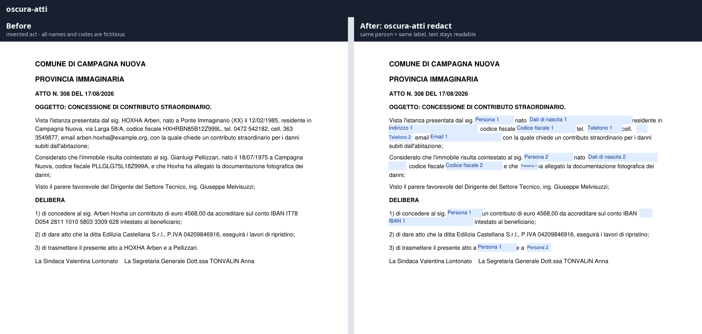
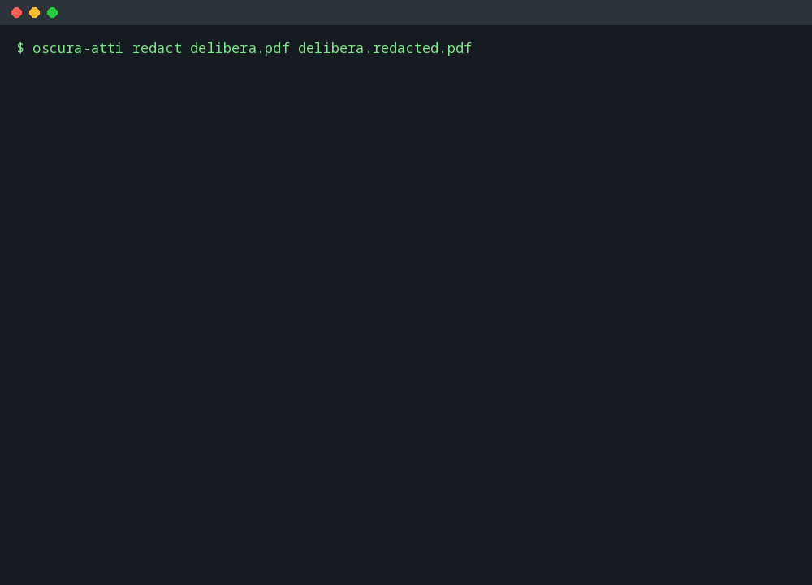
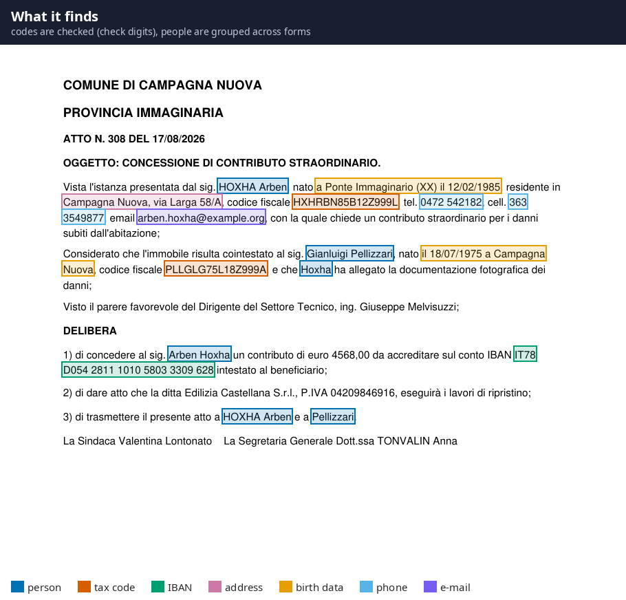
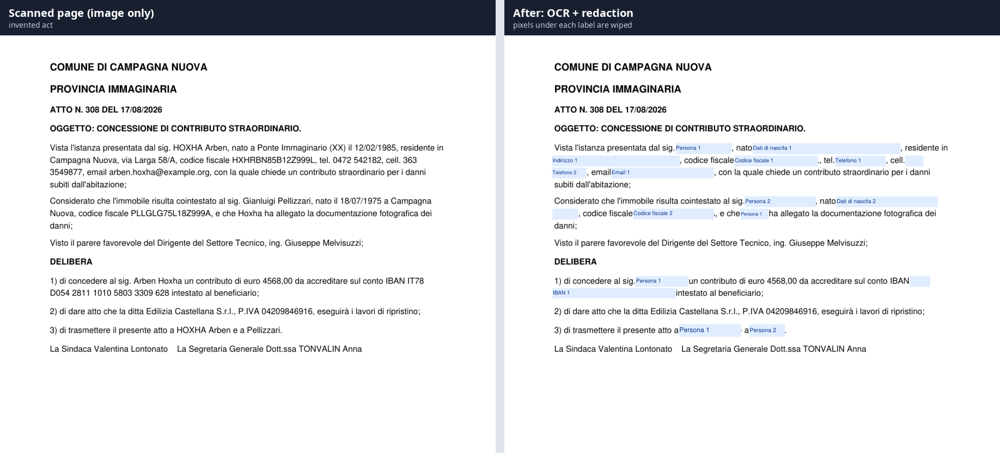

# oscura-atti

**English** · [Italiano](README.it.md)

[](https://github.com/francescor/oscura-atti/actions/workflows/tests.yml)
[](https://pypi.org/project/oscura-atti/)
[](https://registry.modelcontextprotocol.io/v0.1/servers?search=io.github.francescor/oscura-atti)
[](https://scorecard.dev/viewer/?uri=github.com/francescor/oscura-atti)
[](LICENSE)

<!-- mcp-name: io.github.francescor/oscura-atti -->

**Local, rule-based redaction of personal data (PII): no cloud, no machine learning required. Use it as an
MCP server for Claude and other AI agents, from the command line, as a Python library or as a Docker image.**

It redacts public-sector documents (PDF, digitally signed `.p7m`, Word/Excel/OpenDocument, images, text) so
they can be republished, replacing every value with a **consistent label** instead of a black box:

> Vista l'istanza del sig. **Persona 1**, nato **Dati di nascita 1**, residente in **Indirizzo 1**,
> codice fiscale **Codice fiscale 1** … di concedere al sig. **Persona 1** un contributo da accreditare
> sull'IBAN **IBAN 1** … di trasmettere copia a **Persona 1** e alla sig.ra **Persona 2**.



<p align="center"></p>
<p align="center"><em>Demo on an invented act (<a href="docs/media/demo.mp4">MP4 video</a>). Every name, code and address in these images is fictitious.</em></p>

The same person is always `Persona 1` / `Person 1` throughout the document, a different person is
`Persona 2`, and so on for tax codes, IBANs, addresses, birth data, phones, e-mails, plates and ID
documents. The text stays readable and the story of the act stays understandable; the people do not.

At a glance:

- **Runs on your machine.** Documents are not sent anywhere, and nothing is stored, not even the
  mapping between values and labels.
- **MCP server** with two tools, `analyse_pdf` and `redact_pdf`: an AI agent can produce the redacted
  copy from a file path and gets back a report without the personal values ([setup](#mcp-server)).
- **Checks its own output.** The redacted copy is read back (OCR included) and any value still
  extractable is reported; doubtful documents end with outcome `review`, for a person to decide.
- **Built and tested on Italian public-sector acts.** Packs for UK, Spanish, French and German codes
  and courtesy titles are included, but the benchmark and the real-world run below are Italian.

It started as an answer to a question on the Developers Italia forum: [*API/MCP per oscurare i dati
personali nelle delibere a fine pubblicazione in albo?*](https://forum.italia.it/t/api-mcp-per-oscurare-i-dati-personali-nelle-delibere-a-fine-pubblicazione-in-albo/49338)

## Why

Many public bodies in Europe must publish their acts for a limited time. In Italy, municipal
resolutions, orders and decisions stay on the *Albo pretorio online* for 15 days; after that,
the Italian Data Protection Authority (Garante, guidelines 243/2014) says personal data in them may
no longer be disseminated: whoever keeps them online — the body itself, or a civic archive that
preserved them — must remove the personal data first. Doing this by hand, document by document, does
not scale. `oscura-atti` does the mechanical part and tells the human what needs a decision.

## How it works

1. **Text model.** The PDF is read character by character, keeping each glyph's position. Scanned
   pages (or pages that are mostly an image, e.g. a scan with a registry stamp on top) are OCR'd with
   Tesseract.
2. **Recognizers** (rules, no cloud, no machine learning required):
   - codes **with check digits**: Italian *codice fiscale* (also *omocodia* and OCR-damaged codes),
     *partita IVA*, IBAN (all SEPA countries), payment cards (Luhn), UK National Insurance and NHS
     numbers, Spanish DNI/NIE, French NIR, German Steuer-ID;
   - phone numbers, e-mails, vehicle plates and identity documents (with context);
   - **birth data** ("nato a Treviso il 03/04/1971") and **home addresses** ("residente in via …");
   - **people**: courtesy titles (sig., dott.ssa, Mr, Mme, Frau, Doña…), "il sottoscritto",
     "nato a", relation words ("a favore di", "coniuge", "defunto", "cittadino"…), and the
     `SURNAME Name` form typical of lists and minutes.
3. **Entities.** Mentions of the same person are merged ("Mario Rossi", "ROSSI Mario", "Rossi",
   OCR variants), then every other occurrence of that surname in the document is found too.
4. **Decisions.** Public figures stay readable: names in your configuration (mayor, councillors,
   officials), and names next to a public role ("il Dirigente", "Sindaca", a list under
   "Consiglieri:"). Organisations (`S.r.l.`, `ditta`…) are not people.
5. **Rewrite.** Text under each box is removed from the PDF (not just covered), image pixels are
   wiped, the label is written in place; metadata, attachments, annotations and form fields are
   removed; a one-line footer explains it: *"Document generated from the original by redacting
   personal data; names of officials acting in their public role remain visible"* (in the language
   of the labels). **If there is nothing to redact, the output is the original file, byte for byte**:
   same SHA-256, digital signature preserved, no footer. If personal data is only in the file
   properties (author, title…), only those are removed and the footer says the text is unchanged.
6. **Verification.** The output is read back (and OCR'd again for scanned pages): any redacted
   value still extractable is reported as a leak.

Nothing is stored: the mapping between values and labels exists only during the call.

| What it finds | Scanned pages too |
|---|---|
|  |  |

## Install

```bash
pip install oscura-atti          # or run it without installing: uvx oscura-atti --help
# OCR for scanned pages:
sudo apt install tesseract-ocr tesseract-ocr-ita   # or -eng, -spa, -fra, -deu
```

Python ≥ 3.11. PDF handling uses [PyMuPDF](https://pymupdf.readthedocs.io/) (AGPL), hence this
project is AGPL-3.0 too. Optional: LibreOffice (`soffice`) to convert office documents; the `ner` extra
(`pip install "oscura-atti[ner]"`, ~2 GB with PyTorch) for a neural model that finds names with no
contextual cue at all.

MCP clients that read the [official MCP Registry](https://registry.modelcontextprotocol.io/v0.1/servers?search=io.github.francescor/oscura-atti) can install it from there:
the entry `io.github.francescor/oscura-atti` starts it with `uvx oscura-atti mcp` or with the Docker image.

## Docker

A ready image with OCR (Tesseract: Italian, English, Spanish, French, German) and LibreOffice is
published at `ghcr.io/francescor/oscura-atti` (linux/amd64 and linux/arm64) by the `publish` GitHub
workflow. The container runs as an unprivileged user; `/data` is the only folder the tools can read and
write by path.

Release images are signed with [cosign](https://docs.sigstore.dev/) (keyless, by the GitHub workflow)
and carry an SBOM and build provenance. To check that an image was built from this repository:

```bash
cosign verify ghcr.io/francescor/oscura-atti:0.1.1 \
  --certificate-identity-regexp '^https://github.com/francescor/oscura-atti/\.github/workflows/publish\.yml@refs/tags/v' \
  --certificate-oidc-issuer https://token.actions.githubusercontent.com
```

**One-off use (command line):**

```bash
docker run --rm -v "$PWD:/data" ghcr.io/francescor/oscura-atti redact /data/act.pdf /data/act.redacted.pdf
docker run --rm -v "$PWD:/data" ghcr.io/francescor/oscura-atti batch /data/in /data/out --jobs 4 --learn-public
```

**MCP server with Docker Compose** ([`docker-compose.yml`](docker-compose.yml)): listens on
`http://127.0.0.1:8000/mcp`, documents in `./data`.

```bash
docker compose up -d
claude mcp add --transport http oscura-atti http://127.0.0.1:8000/mcp     # Claude Code
docker compose run --rm oscura-atti redact /data/act.pdf /data/act.redacted.pdf
```

**Docker Swarm stack behind Traefik** ([`deploy/swarm-stack.yml`](deploy/swarm-stack.yml)): two
replicas, rolling updates, memory limits, TLS, and authentication through authentik forward auth
or Traefik basic auth (the server has no authentication of its own: never expose it without).

```bash
docker stack deploy --with-registry-auth --prune -c deploy/swarm-stack.yml oscura-atti
```

Build it yourself: `docker build -t oscura-atti .` (add `--build-arg WITH_OFFICE=false` for a
smaller image without LibreOffice, `--build-arg OCR_LANGS="ita eng"` to choose OCR languages).

## Command line

```bash
oscura-atti sample sample.pdf                     # an INVENTED act to try the tool on
oscura-atti analyse sample.pdf                    # what would be redacted, with values (for the operator)
oscura-atti redact sample.pdf sample.redacted.pdf --report report.json
oscura-atti redact act.pdf out.pdf --keep "Mario Rossi" --add "Giulia Ghiotto"   # human corrections
oscura-atti batch in_dir/ out_dir/ --config org.json --jobs 8
oscura-atti redact letter.pdf out.pdf --language en --packs common,uk
oscura-atti redact form.docx form.redacted.pdf     # office documents and images become redacted PDFs
```

`redact` exits with code 2 when the outcome is `review`: **do not publish those without a human
check.** Reasons for `review`: ambiguous names, flagged types, special-category hints (health, minors,
social assistance) near a private person, pages that could not be analysed, or leaks found by the
verification.

## MCP server

```bash
oscura-atti mcp                      # stdio
oscura-atti mcp --http --port 8000   # Streamable HTTP at /mcp
```

Claude Code, with file paths allowed inside the current folder:

```bash
claude mcp add oscura-atti -e OSCURA_ATTI_DIR="$PWD" -- uvx oscura-atti mcp
```

Then ask, for example: *"Redact act.pdf with oscura-atti into act.redacted.pdf and tell me the outcome"*.
With `path` and `output_path` the agent never handles the document itself: `redact_pdf` returns only
the report, without values. `analyse_pdf` does return the values, for the operator's review. Tools:

| tool | what it does |
|---|---|
| `analyse_pdf(pdf_base64 \| path, config, add, keep, filename)` | entities found, with the label each will get and the values (for the operator) |
| `redact_pdf(pdf_base64 \| path, output_path, config, add, keep, filename)` | redacted PDF (Base64 or file) + report without values |

`filename` tells the format of non-PDF input (`.docx`, `.png`…).

File paths work only inside the folder named by `OSCURA_ATTI_DIR`.

## Configuration

```json
{
  "language": "it",
  "packs": ["common", "it"],
  "public_persons": ["Lucia Esemplari", "Paolo Modellini"],
  "public_domains": ["comune.example.it"],
  "public_values": ["0499 000000"],
  "policy": {"VAT_NUMBER": "flag", "PLATE": "redact"},
  "labels": {"PERSON": "Cittadino {n}"},
  "style": "label",
  "stamp": "",
  "ocr": true,
  "ocr_language": "ita"
}
```

- `language`: labels and stamp (`it`, `en`, `es`, `fr`, `de`).
- `packs`: `common` (e-mail, IBAN, cards, international phones) + `it`, `uk`, `es`, `fr`, `de`.
- `policy`: per type, `redact` (with contextual exceptions: office phones and mailboxes,
  organisations' VAT numbers and IBANs), `always`, `flag` (keep readable, report it) or `keep`. Types: `PERSON`,
  `TAX_CODE`, `ID_DOCUMENT`, `HEALTH_ID`, `IBAN`, `PAYMENT_CARD`, `EMAIL`, `PHONE`, `BIRTH`,
  `ADDRESS`, `PLATE`, `VAT_NUMBER`.
- `style`: `label` (light box) or `black` (black box, white label). `stamp`: `""` default footer,
  `null` none, or your own text.

## Quality

`python -m oscura_atti.bench --n 500 [--scanned-every 1]` generates invented acts with ground truth
and measures leaks (private values still extractable) and over-redaction (public names lost).

Current results (v0.1.0, November 2026):

| test set | documents | private values | leaked | public values | wrongly redacted |
|---|---|---|---|---|---|
| invented acts, born-digital | 600 | 4,113 | 0 | 2,403 | 0 |
| invented acts, scanned (OCR) | 60 | 385 | 0 | 253 | 0 |

First real-world run: the expired acts of one Italian municipality's notice board (405 files:
PDF, Word, Excel, images, a zip; 2,344 pages, 86 of them OCR'd): 100 documents redacted, 291
returned unchanged (nothing to redact), 13 with personal data only in the file properties; no value
still extractable after redaction, 7 documents flagged for review. Every false positive and false
negative found while reviewing that run (by hand and with a neural NER model as a second opinion)
became an invented regression test.
The test suite (`pytest -n auto`) has about 140 cases. On real documents, always review outcomes marked
`review`; the tool is an assistant to a human decision, not a replacement for it.

What the rules learnt from real municipal acts (each case is now an invented regression test):
upper-case headings are not people ("DISPOSIZIONI FINALI"); a given name must be a real one
("ROSSI Mario" yes, "DIFESA Civile" no); streets, schools and associations named after people stay
readable ("via don E. Fantasin", "I.S.I.S. Domenico Inventati", «Ing. X» as an association name);
officials appear as "il documento è stato firmato da", "sostituito in caso di assenza dal Dott.",
"Responsabile del procedimento:"; office phones, mailboxes and organisations' VAT numbers and IBANs
are not personal data; OCR reads the same tax code differently on different pages.

Known limits: names with no contextual cue and no known given name are found only if they also
appear elsewhere with a cue (or with the optional NER model, `"ner": true`); handwriting is not read;
a value split by hyphenation at line end may be missed; professionals (engineers, lawyers) are
redacted like any private person unless listed in `public_persons`.

### Batch over an archive: learning who is public

For a whole archive, run a first pass that collects the names kept because of a public role in
at least two documents, review that list, and pass it as `public_persons` to the second pass: the
officials who sign hundreds of acts then stay readable everywhere, even where no role word is near.

## Never commit documents

Real documents contain personal data. This repository refuses them: `.gitignore`, a pre-commit
hook (`git config core.hooksPath .githooks`) and a CI check (`tools/check_forbidden_files.py`, which
also inspects file contents). Tests generate invented documents at runtime (`oscura_atti.synthetic`).
The only exception is `docs/media/`: images and video generated by `tools/make_media.py` from an
invented act (PDFs are refused there too).

## Languages of this repository

The README exists in English and Italian (`README.md`, `README.it.md`): a commit that changes one
must change the other too (pre-commit hook and CI check, `tools/check_translations.py`).

## Contributing and security

See [CONTRIBUTING.md](CONTRIBUTING.md) and the [changelog](CHANGELOG.md). A personal value still readable
in a redacted copy is a **security issue**: report it privately as described in [SECURITY.md](SECURITY.md),
never with the real document.

## Licence

AGPL-3.0-or-later. Use it, change it, run it as a service — and share your improvements.
